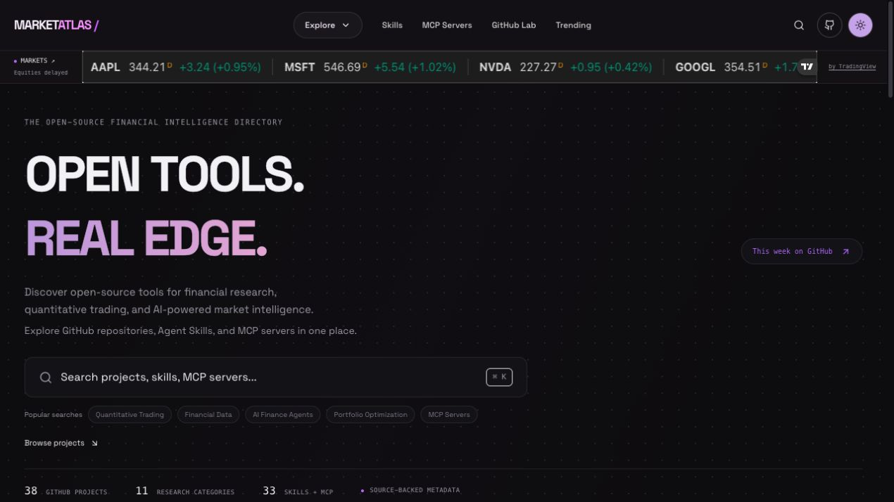
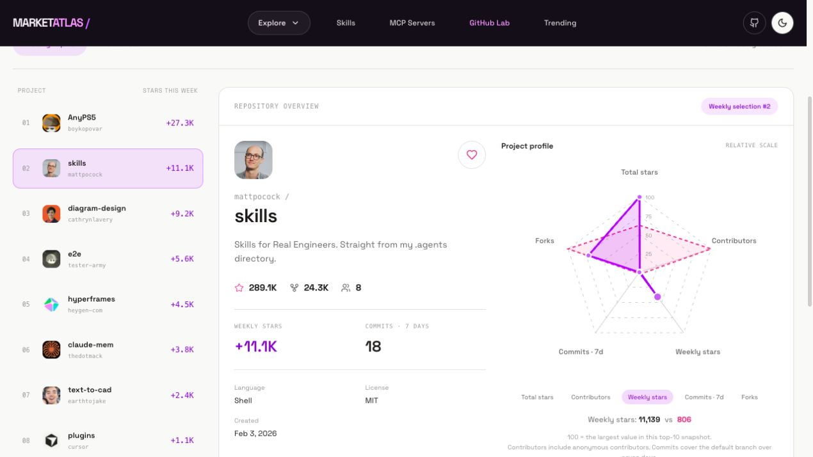

<div align="center">

# MarketAtlas

**Open tools. Real edge.**

Discover financial research projects, agent skills, and MCP servers—then explore what is gaining attention across GitHub.

[](https://github.com/jeffsasha/market-atlas/actions/workflows/ci.yml)
[](#license)
[](https://github.com/jeffsasha/market-atlas/stargazers)
[](https://github.com/jeffsasha/market-atlas/commits/main)
[](https://nextjs.org/)
[](https://react.dev/)
[](https://www.typescriptlang.org/)

[Features](#features) · [Visit website](https://market-atlas-indol.vercel.app/) · [GitHub Lab](#github-lab) · [Data](#real-github-data) · [License](#license) · [Contributing](CONTRIBUTING.md)

</div>



## Features

| Explore | What you can do |
| --- | --- |
| **Projects** | Browse 38 curated GitHub repositories across 11 finance and crypto categories; filter, sort, and open repository previews. |
| **Skills** | Discover 25 individual agent skills with verified source manifests, pinned revisions, topic filters, and upstream links. |
| **MCP servers** | Explore 8 documented financial data connections with source and setup links. |
| **GitHub Lab** | Follow a weekly top 10 across all project categories, inspect repository profiles, compare radar charts, and save favorites locally. |
| **Trending** | Explore financial community favorites and verified weekly growth when enough history is available. |
| **Design gallery** | Preview the site's components and their usage examples at `/design`. |

A quiet, shared dot-grid background, muted lavender/pink accents, a one-time React Bits StrokeText headline, a dark navigation bar with a white mega menu, and a PixelSwap theme transition give the catalog a consistent visual language. The hero opens the shared command palette, and a compact TradingView ticker sits beneath navigation. Light/dark themes, keyboard navigation, focus handling, reduced motion, and a brief ambient-background entrance are included.

## Visit website

[**Open MarketAtlas →**](https://market-atlas-indol.vercel.app/)

## Search and market ticker

The hero search button and navigation search icon open a shared command palette. Press **⌘K**, **Ctrl+K**, or **/** outside an editable field. Use ↑/↓ and Enter to open a result, Tab to move through controls, and Escape to close. Focus stays inside the dialog and returns to its opener.

Search runs instantly against the actual bundled/refreshed catalog. `lib/search.ts` builds one index of projects, individual Skills, and MCP servers; the palette and `/api/search?q=...&type=projects|skills|mcp` use the same search engine. Matching includes names, descriptions, repositories, tags, and category labels. Project results open internal detail pages; Skills and MCP results open their verified upstream source documentation in a new tab. Suggestion chips use existing catalog categories.

The layout embeds the [official TradingView Ticker Tape](https://www.tradingview.com/widget-docs/widgets/tickers/legacy-ticker-tape/) for AAPL, MSFT, NVDA, GOOGL, AMZN, META, TSLA, SPY, QQQ, and Coinbase BTC/USD, ETH/USD, SOL/USD. **No market API key is required.** Market data stays within TradingView's widget; MarketAtlas does not scrape, cache, or redistribute its quote values.

US equity data is labeled **delayed**. Provider badges show the actual delay (currently 15 minutes in the verified embed), market status, and symbol availability. Crypto availability and updates depend on the provider. The widget does not expose a reliable quote timestamp to the host, so MarketAtlas does not invent one or label equity quotes as real-time. Outside market hours, the provider supplies its latest available data and status.

The provider marquee pauses on hover; reduced-motion preferences stop its animation and allow manual horizontal scrolling. The Markets menu offers stable keyboard-accessible links to all twelve instruments. Loading and script/iframe failure states keep the strip's size stable and display em dashes and unavailable labels, never fake prices. Retry reconnects the widget. Provider-internal failures remain governed by its own unavailable indicators; an iframe load alone cannot prove every quote is available.

TradingView branding and attribution remain visible. Display rights and exchange restrictions follow [TradingView's widget data terms and availability](https://www.tradingview.com/widget-docs/faq/data/); availability can vary by geography, provider changes, content blockers, and exchange restrictions. Do not treat embedding the widget as permission to extract or resell market data.

## GitHub Lab



The homepage's weekly top 10 links directly to repository profiles at `/lab`. The Lab covers **all languages and all project categories** in GitHub's public weekly Trending selection, ranked by its reported weekly stars. The selection is not an exhaustive ranking of every GitHub repository.

Profiles show total stars, forks, contributors, weekly stars, seven-day default-branch commits, language, license, and creation date. The radar chart scales each metric against the largest value in the same top ten. Compare a second project to see the profiles together; select a metric to inspect its raw values.

Favorites are saved on the visitor's device using repository IDs. They do not change GitHub stars, and the Favorites view shows saved projects present in the current snapshot.

```bash
npm run refresh:weekly -- --snapshot
```

The checked-in fallback is `data/github-weekly.json`; the latest local refresh is `data/weekly-cache.json`. Capture time appears in the UI. Refreshes are manual, preserve the previous snapshot on incomplete feeds or required metadata failures, and keep unavailable optional metrics empty.

## Real GitHub data

The catalog mirrors **metadata and links** to upstream projects. It does not bundle their packages, run their instructions, or copy their credentials.

| File | Role |
| --- | --- |
| `data/sources.json` | Curated repositories, Skill source paths, and MCP documentation paths. |
| `data/catalog.json` | Bundled financial catalog, available immediately after cloning. |
| `data/cache.json` | Ignored latest local financial-catalog refresh. |
| `data/history.json` | Ignored daily observations used to calculate real seven-day growth. |
| `data/github-weekly.json` | Bundled GitHub Lab snapshot. |
| `data/weekly-cache.json` | Ignored latest local Lab refresh. |

```bash
# Refresh the financial catalog.
npm run discover

# Also update the bundled fallback; review the resulting data diff.
npm run discover -- --snapshot

# Refresh just one source.
npm run discover -- --only=alpacahq/alpaca-mcp-server --snapshot
```

Repository facts come from GitHub, while category memberships are editorial. Skills require actual source manifests, and MCP entries require repository documentation. Source verification confirms discovery metadata; it is not a security audit or endorsement.

Financial weekly growth requires an observation seven to eight days old. Until that history exists, the financial Trending section is labeled **Popular right now** and sorts by total stars. No automatic refresh schedule or live database is configured. The optional schema under `db/migrations/` is not connected to the current file-backed app.

## Development

```bash
npm test
npm run build
npm run typecheck
```

GitHub Actions runs these checks on pushes to `main` and `codex/**` branches, and on pull requests. Tests cover catalog categories, stable Skill identities, source provenance, manifest parsing, weekly ranking, and radar normalization. Browser verification covers filtering, previews, themes, Lab comparisons, favorites after reload, and mobile layout.

```text
app/                     Pages and API routes
components/              Navigation, cards, motion, previews, and charts
data/                    Bundled catalogs and source manifest
lib/                     GitHub client, filtering, provenance, and snapshots
scripts/discover.ts      Financial catalog refresh
scripts/refresh-weekly.ts GitHub Lab refresh
tests/                   Data and ranking checks
docs/images/             README screenshots
.github/workflows/       Automated validation
```

## Documentation and contributions

- [Architecture](ARCHITECTURE.md) — routes, components, and data flow.
- [Data ingestion](DATA_INGESTION.md) — source verification and snapshot rules.
- [Design system](DESIGN_SYSTEM.md) — colors, typography, motion, and accessibility.
- [Contributing](CONTRIBUTING.md) — local checks and adding catalog sources.
- [Report an issue](https://github.com/jeffsasha/market-atlas/issues) — bugs and feature requests.

## License

MarketAtlas's original code and documentation are licensed under the [MIT License](LICENSE). Copyright © 2026 [Jeff Lu (@jeffsasha)](https://github.com/jeffsasha). You may use, modify, and distribute the original code, including commercially, provided you retain the copyright and license notices. The software is provided without warranty.

Third-party materials are excluded from this MIT grant and retain their own licenses and terms:

| Material | License or terms |
| --- | --- |
| React Bits components and adaptations | [MIT + Commons Clause](components/LICENSE.react-bits.md); retain the upstream notices and restrictions. No React Bits Pro component or license key is included. |
| Space Grotesk font | [SIL Open Font License 1.1](app/fonts/OFL.txt); bundled locally so builds do not fetch it from Google Fonts. |
| Other dependencies | Their respective upstream licenses. |
| Indexed GitHub projects, Skills, and MCP servers | Their respective upstream licenses; catalog inclusion does not relicense them. |
| TradingView widget and market data | [TradingView's widget terms and availability](https://www.tradingview.com/widget-docs/faq/data/); this project's MIT License grants no rights to extract or redistribute provider data. |
